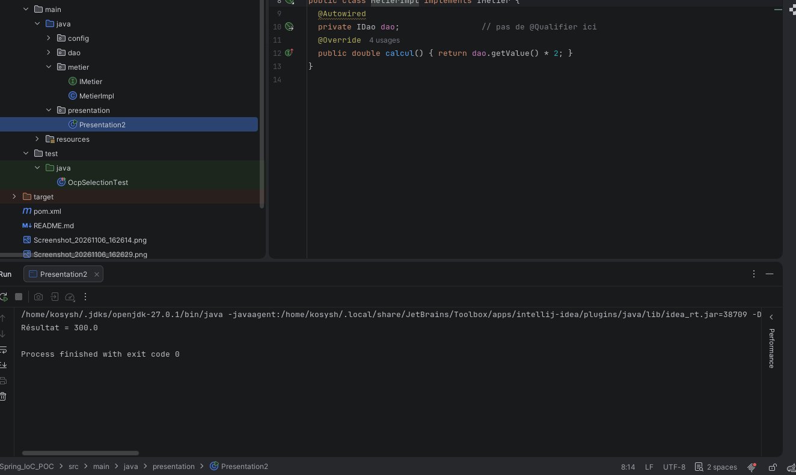
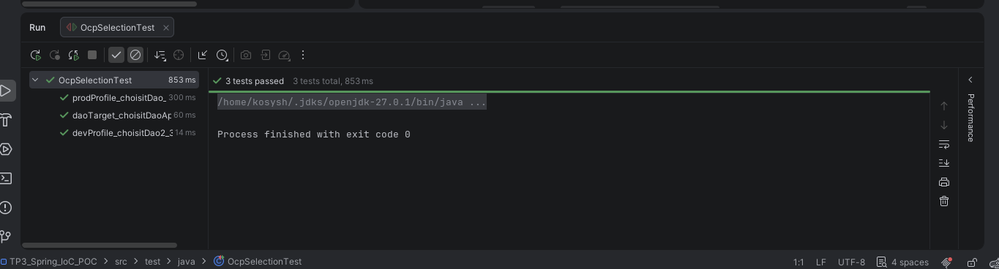

# TP3 — Spring IoC & POC

Spring choisit le DAO à injecter dans `MetierImpl`. Le métier double la valeur reçue et `Presentation2` affiche le résultat. On peut changer de DAO par la configuration.

## Exécution dans IntelliJ IDEA

Ouvrir le projet Maven dans IntelliJ IDEA avec le JDK 17 et lancer `presentation.Presentation2`. Le projet utilise Spring Context 5.3.30.

La capture montre l’injection avec `@Autowired` dans `MetierImpl` et le résultat `300.0` dans la console.

## Profils Spring

Dans **Run → Edit Configurations → VM options**, utiliser `-Dspring.profiles.active=prod`. Remplacer `prod` pour sélectionner un autre profil. Les résultats vérifiés sont `200.0` pour `prod`, `300.0` pour `dev`, `360.0` pour `file` et `440.0` pour `api`.

## Variante A — Priorité avec `@Primary`

Avec `-Dspring.profiles.active=primary`, `DaoPrimaryConfig` donne la priorité à `DaoImpl2`. Le résultat vérifié est `300.0`.

## Variante B — Alias avec `@Bean`

Avec `-Dspring.profiles.active=alias`, `DaoAliasConfig` expose `DaoApi` sous le nom `dao`. Le résultat vérifié est `440.0`.

## Variante C — Sélection par propriété

Vider le champ **VM options**, modifier `dao.target` dans `src/main/resources/app.properties` et relancer. Les résultats vérifiés sont `200.0` pour `dao`, `300.0` pour `dao2`, `360.0` pour `daoFile` et `440.0` pour `daoApi`.

## Tests JUnit 4

Lancer `OcpSelectionTest` dans IntelliJ ou exécuter `mvn test`. Les trois tests passent. Ils couvrent les profils `dev` et `prod` et le choix de `daoApi` par propriété.

**Captures des variantes à compléter.** La capture d’exécution montre le résultat, mais la configuration active reste à montrer.

## Captures de référence du TP3 Microservices

Ces captures proviennent du projet Microservices précédent.

- [Priorité avec @Primary](Screenshot_20261014_092102.png) — l’ancien exemple donnait la priorité à `DaoImpl` et affichait `200.0`.
- [Exécution de l’alias vers DaoApi](Screenshot_20261014_092708.png) — l’ancienne console indique que la source API est utilisée.
- [Sélection de DaoApi par propriété](Screenshot_20261014_095033.png) — l’ancien exemple affichait `440.0`.
- [Exécution JUnit dans IntelliJ](Screenshot_20261014_102607.png) — la capture montre un seul test de l’ancien projet.
